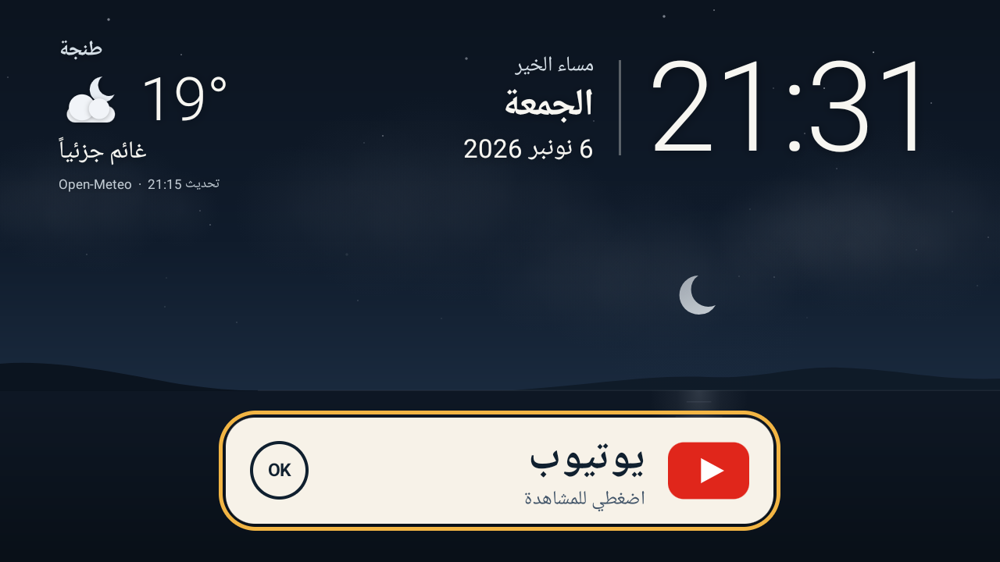
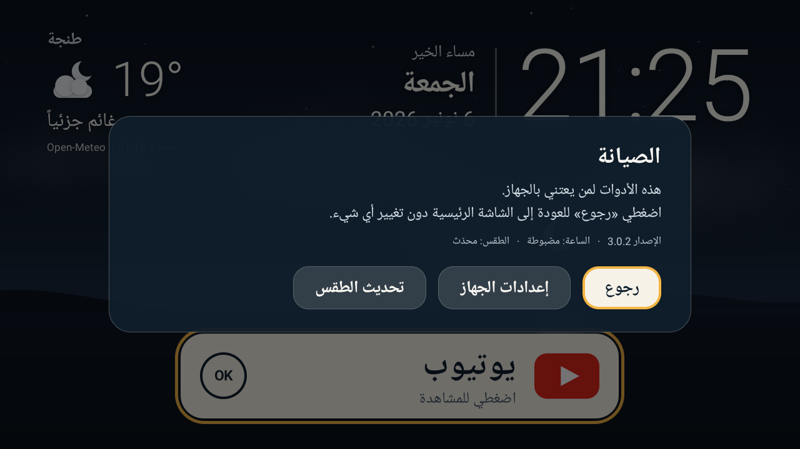
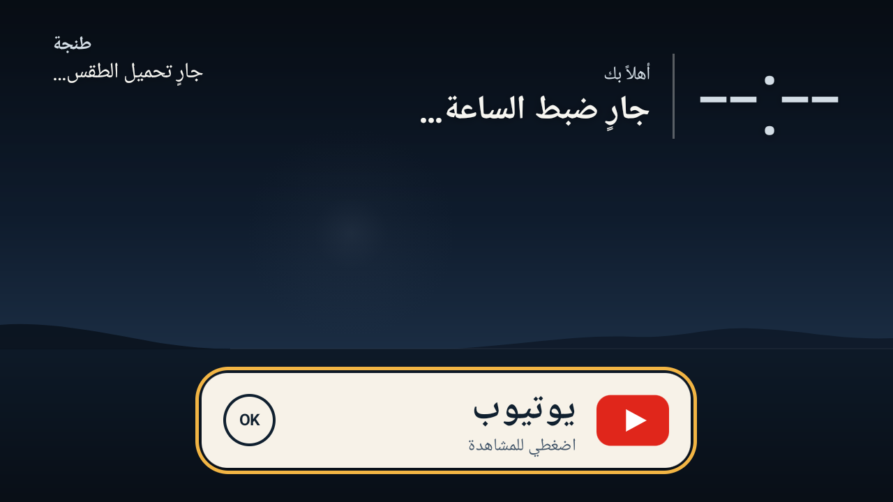
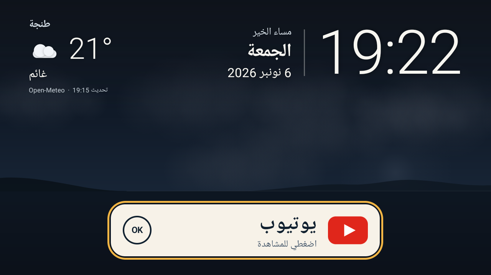
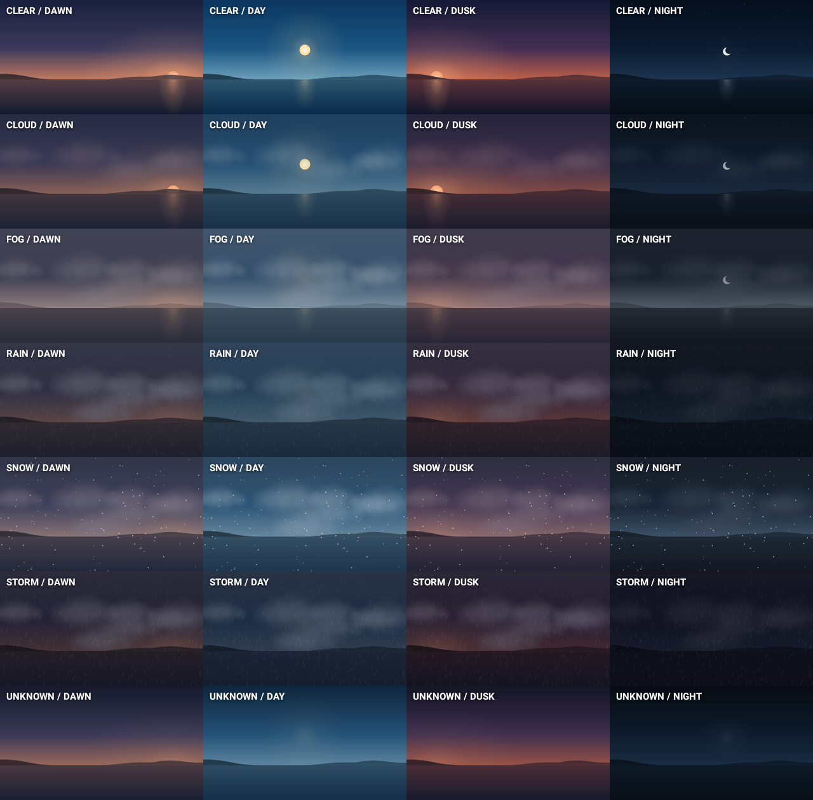

# Arabic TV Home

**A calm, one-button Android TV home screen made for my grandmother.**



My grandmother watches YouTube on a cheap X96Q Android TV box. When it was investigated (with AI agents, as described below), the box turned out to be infected with botnet malware, cluttered with vendor stores and remote-management apps, and set to the wrong date, so YouTube would not even connect. The full recovery is written up in the companion research project. This repository is the part she actually sees: what replaced the vendor launcher after the documented cleanup. Firmware integrity remains unverified.

The rules were simple. She turns on the TV and sees a clear, beautiful Arabic screen with the time, the day, and the weather in Tangier. There is **one** thing to do: press OK and YouTube opens. There are no app grids to choose from, no search box, and no settings she could open by accident.

## Engineering decisions

The constraint was independent use with a TV remote. I chose one action instead of an app grid or a search workflow, kept maintenance behind a deliberate gesture, and kept Arabic local to the Activity so other apps retained their existing language. Those requirements drove the implementation and acceptance checks.

The reliability work matters as much as the screen: recover when the clock is set after boot, recover when networking arrives late, reject stale forecasts, and return from Settings with focus intact. The tests below separate pure-model checks, synthetic renders, and real-device interaction. This is a working family deployment; a formal usability study with my grandmother has not been performed.

## What it does

- **One focusable action.** The YouTube card is focused whenever Home appears. Arrow keys cannot move focus anywhere else. One OK opens YouTube, and a second OK within 1.5 s is ignored. BACK stays on Home.
- **Arabic only inside the launcher.** The device stays in its own locale (French on her box). Text is Moroccan Arabic, right-to-left, with Latin digits `0123456789` everywhere: clock, date, temperature and status.
- **A sky that matches outside.** The background shows the Strait of Gibraltar from Tangier. It follows dawn, day, dusk and night, plus clear, cloudy, fog, rain, snow and storm weather. Sun position is computed offline, so time of day stays right without Internet.
- **Honest weather.** It uses Open-Meteo over HTTPS for a fixed city, with no API key, no location permission and no device identifier. Forecasts older than 3 hours, set in the future, or arriving while the box clock is still wrong are not shown. When weather is unknown the sky is neutral, never a made-up sunny day.
- **Survives bad boots.** Cheap boxes often start with the wrong time and late Wi-Fi. The clock shows `--:--` and "setting the clock…" until the time is plausible, then recovers on the system time-change event. Weather retries with backoff, and immediately when connectivity changes.
- **Hidden maintenance.** Three distinct MENU presses within 2 seconds open a small Arabic panel for whoever looks after the box: back, device settings, refresh weather. A single press, a held key, a repeat or an interrupted sequence does nothing.
- **Small and boring on purpose.** Native Java Android Views, no libraries, no bundled fonts or images, about 37 KB. The only permission is `INTERNET`. There is no background service and no render loop. The sky is redrawn only when something changes.

| Maintenance panel (triple MENU) | Clock not yet synchronised → restored |
|---|---|
|  |   |



*Sky states rendered offscreen on the X96Q from the real view code with synthetic weather. The images in the table above are framebuffer captures of the running app.*

## Build

You need a JDK (8 or newer, tested with 17), Python 3, and the Android SDK command-line tools: `build-tools;36.0.0` and `platforms;android-36`. Gradle is not used.

```sh
export ANDROID_HOME=~/Android/Sdk          # default if unset
python3 -B build.py                        # → build/arabic-tv-home.apk
```

On first run, `build.py` creates a signing key in `private/`, which is git-ignored. **Keep that key.** Android only accepts an update signed with the same key. To use your own key:

```sh
python3 -B build.py --keystore my.jks --ks-pass-file my.pass --key-alias owner --expect-signer <cert sha256>
```

The single action opens `com.google.android.youtube.tv` (stock YouTube for Android TV). To open a different package, use `--youtube-package`. On my grandmother's box it opens the separately packaged build from the research project:

```sh
python3 -B build.py --youtube-package com.google.android.youtube.tx
```

`verify_apk.py` runs automatically. It fails the build unless the APK has `INTERNET` as its only permission, one `classes.dex`, no native code, no assets, a valid signature and, optionally, the signer you expect.

**Reproducibility check (DEX only).** With the tested toolchain, building this repository with `--youtube-package com.google.android.youtube.tx` produces `classes.dex` SHA-256 `f3e8d574123917dbc3d486930713e0c7b85878976aaf96e348797f4503c3690f`, byte-identical to the DEX inside the APK installed on her box. This establishes the compiled application code match; it does not establish byte-for-byte reproducibility of the signed APK. ZIP metadata and signing are separate concerns.

## Install

On a box you own, with adb enabled:

```sh
adb install build/arabic-tv-home.apk
adb shell cmd package set-home-activity local.reroute.youtubehome/.HomeActivity
```

Alternatively, press HOME and choose "البيت" if your box shows a launcher chooser. Disabling the vendor launcher is up to you and depends on the box. The launcher does not need root.

## Tests

```sh
tests/run_model_tests.sh                                   # host JVM, no device needed
python3 -B preview.py --serial <adb-serial> out/           # offscreen renders + layout checks on a device/emulator
YOUTUBE_PKG=com.google.android.youtube.tv tests/remote_test.sh <adb-serial> out/   # 24 remote-control checks
```

- `ModelTest` covers Arabic calendar and digits, the timezone and locale independence, unsynchronised clocks, weather states and freshness, Tangier sunrise and sunset, 112 palette contrast cases, and the MENU and launch gates.
- `preview.py` pushes a temporary dex to `/data/local/tmp`, renders the real view tree for every state through `app_process`, checks safe area, overlap and clipping, and then deletes it. It installs nothing.
- `remote_test.sh` drives the installed launcher with key events only and reads focus through `uiautomator`.

**Recorded results (2026-11-06):** model tests passed; 24/24 remote checks on the real X96Q ([log](docs/evidence/remote-test-x96q-3.0.2.txt), run with the pre-export script targeting the `.tx` package), including the Settings round trip and one OK opening YouTube; 19 offscreen states and 28 sky variants on the X96Q; a real reboot back to Home with late network recovery; and an Android TV emulator cold start with no network ([log](docs/evidence/cold-start-emulator.txt)). Details and limits are in [docs/IMPLEMENTATION.md](docs/IMPLEMENTATION.md).

## Limitations

- **Made for one city and one person.** Tangier is fixed in `Model.LATITUDE/LONGITUDE` and the Open-Meteo URL in `WeatherClient`, and the Arabic is Moroccan. Forking for another city means changing those constants and the solar tests.
- Tested on one Android 10 box at 1280×720, density 213, and on the Android 10 TV emulator. Other resolutions and Android versions have not been tested.
- Contrast is checked at palette stops, not at every composited pixel. The captured images were inspected by eye; readability from the sofa on her actual TV remains unverified.
- The clock-validity cutoff is a fixed date (2026-11-01). On a box whose clock has drifted to a later wrong date, it cannot tell.
- The moon arc is decorative, not astronomical.
- This is a launcher, not a parental-control or kiosk system. Anyone with the remote can reach Settings through the hidden gesture, and anyone with adb can change everything.
- The YouTube logo shape on the card is drawn to identify the app it opens. This project is not affiliated with YouTube or Google.

## How it was made

This was built with AI coding agents, with me setting the requirements, authorising device changes, and deciding the scope. Agents ran the recorded ADB and emulator checks; these are distinct from a person testing usability in the room.

- **Claude** (Anthropic) designed and implemented the 3.0 visual redesign locally: the sky, layout, weather states, maintenance panel and offscreen preview harness. It worked from [this brief](docs/history/redesign-brief.md) and verified on an Android TV emulator.
- **Codex** (OpenAI) reviewed Claude's 3.0 and fixed three edge cases (3.0.1), changed the launch target (3.0.2), and ran the recorded hardware verification. This attribution describes the documented November work; authorship of earlier versions is not assigned here.
- **Claude** prepared this public export: the configurable build, docs and sanitisation. **Codex** subsequently reviewed the export and tightened the evidence and reproducibility claims.
- Design notes: [docs/DESIGN.md](docs/DESIGN.md). Product intent: [docs/PRODUCT.md](docs/PRODUCT.md).

## Related

The companion project, [X96Q Recovery Research](https://github.com/mehdii000/x96q-recovery-research), documents the X96Q recovery: the malware findings, the cleanup and the experimental YouTube TV video-ad loader guard.

## License

Original project code and documentation are licensed under the [Apache License 2.0](LICENSE).

Third-party names, logos and interfaces visible in screenshots retain their respective rights. Referenced or user-supplied third-party software and samples are not covered by this license.
